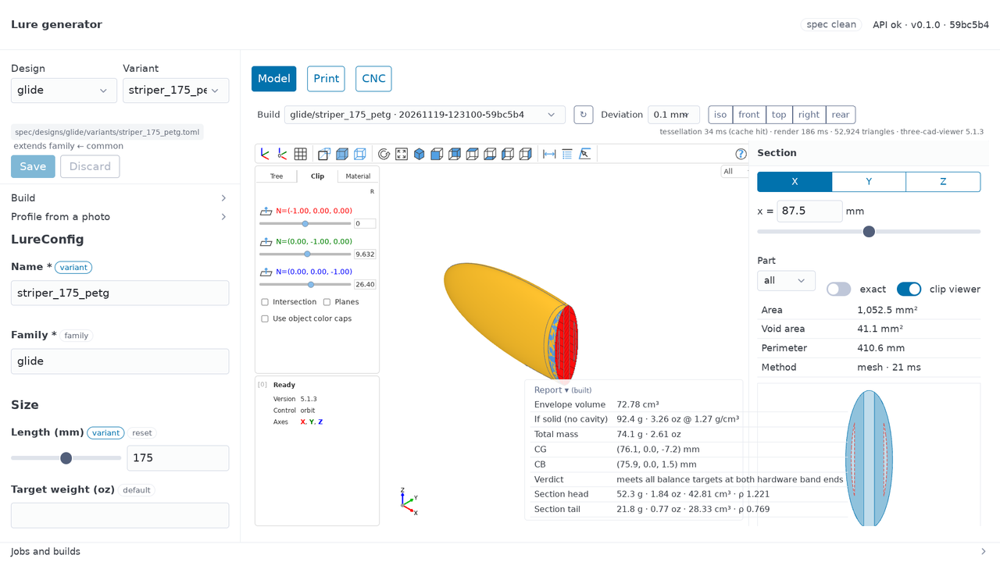
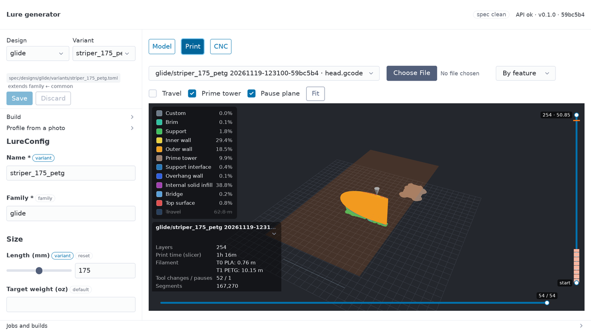
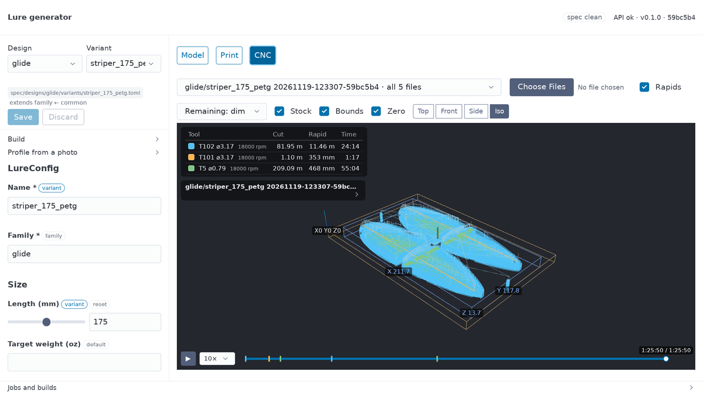
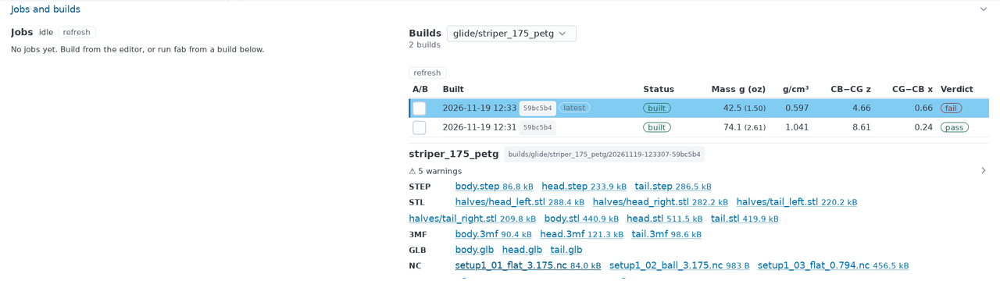

# lure-generator

Code-first, config-driven pipeline for designing and manufacturing fishing lures:

**profile image + TOML spec → balanced CAD model (STEP/STL) → G-code** for a 3D printer (Snapmaker U1 via OrcaSlicer) or a CNC router (Shapeoko 3 XXL / Carbide Motion).

The first lure family is a two-section jointed **glide bait** that hangs level and is tuned to float, suspend or slow-sink in salt water once hardware is added. A local web app sits on top of the same pipeline for editing configs, previewing the model and toolpaths, and running jobs.

Hobby project. The plan and progress live in the GitHub issues: epic #1 (pipeline) and #54 (web app).

## What it does

| Step | Command | Output |
|---|---|---|
| Profile | `lure profile <photo>` | Station table (CSV) from a side-profile photo, with a debug overlay. ArUco marker or known length for scale. |
| Build | `lure build <variant.toml>` | Head and tail sections with joint, cavity, ballast and trim pockets and screw-eye bosses. A balance solver tunes walls, keel and ballast to the sink target and level hang across the hardware weight range. DFM rules check the result. STEP/STL, `report.json`/`report.md`, `resolved.toml`. |
| Check | `lure check <build>` | Re-runs the DFM rules on an existing build. |
| Print | `lure fab <build> --format print` | Upright sections sliced with OrcaSlicer for the U1: tree supports with a PLA/PETG interface under the belly, thumbnails, optional pause. |
| CNC | `lure fab <build> --format cnc` | Two glued halves: glue-face pockets, wire groove and flip pins (setup 1), then 3D roughing, 1/32" finishing and cut-out with tabs (setup 2). One `.nc` per tool by default (BitSetter tool changes), a setup sheet and a cut simulation. |
| Web app | `lure serve` | Config editor, 3D model with section planes, print and CNC toolpath previews, build history and compare, downloads, live jobs. |

Sample variant (`striper_175_petg`, PETG print): 74 g (2.6 oz), slow sink at 1.04 g/cm³, CG within 0.5 mm of CB fore/aft, about 2 h 45 min to print both sections.

## Layout

```
spec/      data only: designs/<family>/ (family.toml, profiles/, variants/), printers/, routers/,
           hardware/, materials.toml
src/       the `luregen` package: profile, geometry, families, physics, dfm, fab/{printer,router},
           report, api (web backend), viewer, commands (CLI)
web/       Vite + Svelte 5 + TypeScript front end
docker/    single-image deploy (API + SPA + OrcaSlicer) and compose file
docs/      deploy guide, viewer binary format
tools/     dev scripts (slicer runtime image, worktree cleanup, issue seeding)
tests/
builds/    generated outputs (gitignored): builds/<family>/<variant>/<stamp>/ with a `latest` link
```

Anything tuned between builds (dimensions, densities, targets, machines, tools, feeds) is TOML/CSV in `spec/`. Configs layer as `spec/designs/_common.toml` ← `family.toml` ← variant ← `--set key=value`, and every build writes its fully resolved config.

## Setup

```
sudo apt-get install -y libgl1 libx11-6 xvfb   # OCP wheel needs libGL/libX11; xvfb for slicer thumbnails
uv sync                                        # Python 3.13
uv run lure --help
```

Slicing needs OrcaSlicer 2.5.1. Its AppImage requires glibc 2.38 (Ubuntu 24.04+); on older hosts it runs in a container built from `tools/orca-runtime/` (selected automatically, see `spec/printers/snapmaker_u1/machine.toml`).

## Usage

```
uv run lure build spec/designs/glide/variants/striper_175_petg.toml [--set buoyancy.target_sink=suspend]
uv run lure check builds/glide/striper_175_petg/latest
uv run lure fab builds/glide/striper_175_petg/latest --format print
uv run lure build spec/designs/glide/variants/striper_175_petg.toml \
  --set process.method=cnc --set process.material=basswood --set process.rigging=through_wire
uv run lure fab builds/glide/striper_175_petg/latest --format cnc
```

A build takes a couple of minutes because the balance solver rebuilds the internals a few times; rebuilding from a `resolved.toml` reuses the solved values.

## Web app

Development (two terminals; Node 24):

```
uv sync --group web && uv run lure serve       # API on :8000
cd web && npm ci && npm run dev                # Vite on :5173, proxies /api
```

Deployment is one Docker image with compose; see [docs/deploy.md](docs/deploy.md). The app has no authentication, so keep it on the LAN.

**Model:** config editor on the left, the built lure with a live section plane, and the balance report.



**Print preview:** sliced G-code by feature, with layer and move scrubbing, the prime tower and the pause plane.



**CNC preview:** all per-tool files of a build as one job, colored by tool, with stock, bounds, work zero and a time scrubber.



**Jobs and builds:** build history with balance numbers and verdicts, compare, and downloads (STEP, STL, 3MF, GLB, G-code, NC, zip).



## Status

The v1 pipeline and web app are complete. Still open:

- CNC builds aren't balanced yet: the solver only tunes print builds (#107).
- Measured hardware weights (#23) and machine/tool details (#28) replace the current placeholders.
- A real profile photo (#9); builds use a preset station table until then.
- Field calibration from tank tests (#29), multi-color zones (#52), a smaller deploy image (#82).
